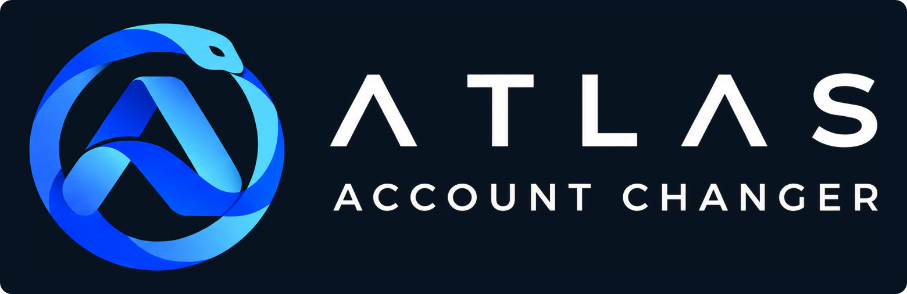
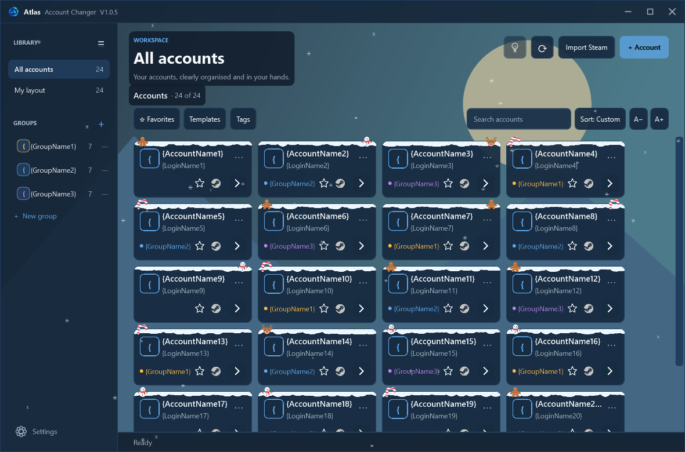
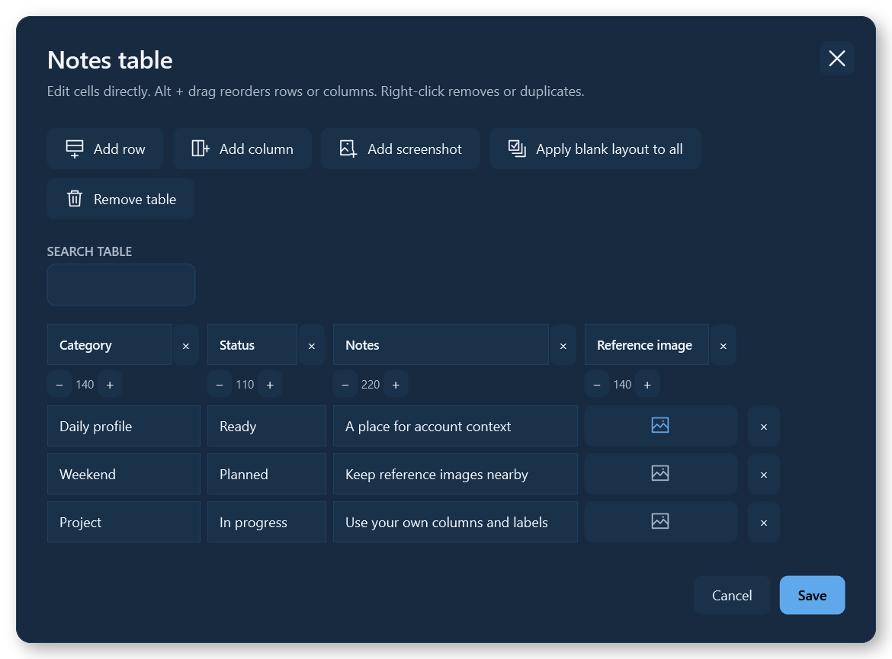
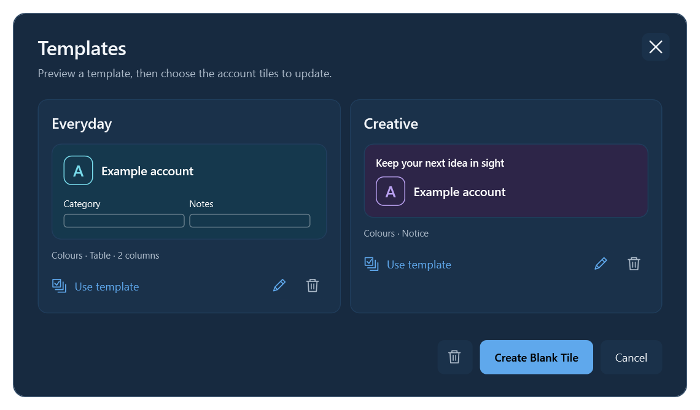
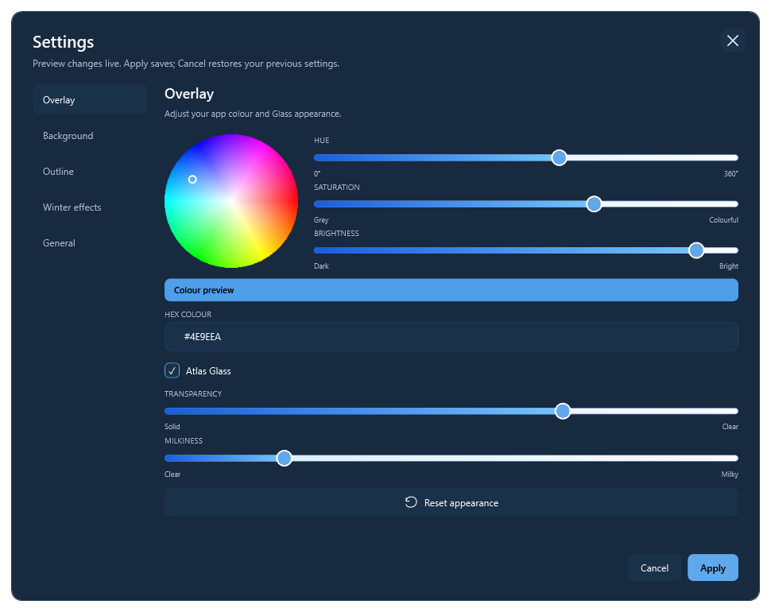
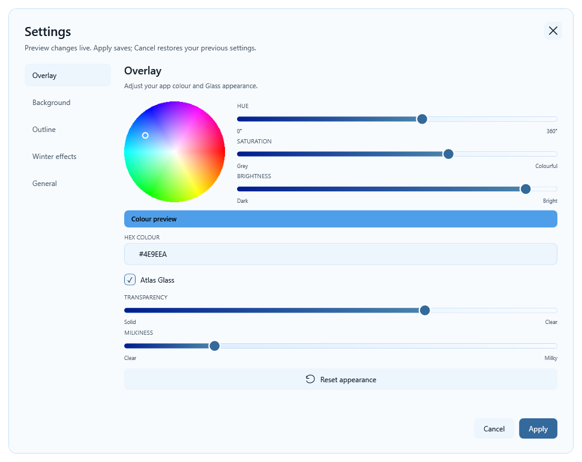
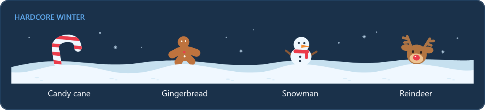

  
  
<strong>Your Steam accounts. Your layout.</strong>

  
Switch accounts and keep their groups, notes and personal workspace together.

  
<a href="https://github.com/BluelineDE/atlas-account-changer/releases/latest"><strong>Download for Windows 64-bit →</strong></a> · <a href="https://github.com/BluelineDE/atlas-account-changer/issues">Report a bug</a>

## What makes Atlas yours

### A library you can actually organise

Keep accounts in groups, mark favorites and give an account several coloured tags. Search and sort your library to get to the account you need.

### See the account Steam is using

An animated outline marks the active Steam account. During a switch, the previous account stays marked until Steam confirms the new one. Choose automatic contrast, your own colour or RGB, with separate controls for the light trail and colour-cycle speeds.

### Your own layout

Arrange tiles and groups in **My layout**, give accounts recognisable colours and keep your preferred order. Tiles glide into their new positions when the window changes size.

### The context belongs with the account

Keep free-text notes, editable tables and independent screenshot columns together. Put an important notice directly on a tile so a reminder is visible before you open its details.

### Design once, reuse with templates

Save a tile design and apply it to selected accounts. Reuse colours, notices and blank table layouts without rebuilding the same setup for every tile.

### Glass, colour and a background of your own

Choose a solid appearance or **Atlas Glass**. Set colours with a wheel or HEX code, adjust transparency and milkiness, and add a JPG or PNG from your PC. Fill/Fit, image intensity and darkening are separate controls.

### A little winter, when you want it

Choose **Off**, **Light** or **Hardcore**. Adjust snowfall speed and optionally pause it while Atlas is unfocused. Hardcore adds snow and randomly chosen candy canes, gingerbread figures, snowmen and reindeer.

## A look inside

<table>
  <tr>
    <td width="50%"><strong>Notes with room for your own structure</strong> </td>
    <td width="50%"><strong>Reusable tile designs</strong> </td>
  </tr>
  <tr>
    <td><strong>Colour and Glass controls</strong> </td>
    <td><strong>A light appearance too</strong> </td>
  </tr>
</table>

  
<strong>Meet the winter companions</strong>

  

*Examples use fictional data. Workspace and appearance views are from V1.0.5. Notes and templates use the local UI preview of existing features; the notes view includes an alignment fix prepared for the next update.*

## Download and install

1. Download the installer from the [latest release](https://github.com/BluelineDE/atlas-account-changer/releases/latest).
2. Close Atlas if it is already running.
3. Open the installer, choose an installation folder and install.

Updating or reinstalling keeps your existing accounts and settings. No separate runtime installation is required.

## Windows SmartScreen

Windows may display **“Windows protected your PC”** or **“Unknown publisher”**. This release is **unsigned**, so Windows cannot verify its publisher through a trusted code-signing certificate. New unsigned files may also have little or no SmartScreen reputation. This warning alone is not a malware detection. [Learn more from Microsoft](https://learn.microsoft.com/en-us/windows/apps/package-and-deploy/smartscreen-reputation).

Download Atlas from this repository's official Releases.

## Updates

Atlas checks GitHub for a newer stable release when it starts and every six hours while it remains open. When an update is available, an indicator appears in the top bar. V1.0.2 opens the release page when you click it. Starting with V1.0.3, Atlas downloads and verifies the installer, then starts setup. Existing users see the new version's patch notes once after updating.

## Other Atlas products

<table>
  <tr>
    <td width="100" align="center"></td>
    <td><strong>ATLAS Notch</strong> A compact desktop bar for your clock, music and account shortcuts. <a href="https://bluelinede-shop.fourthwall.com/en-eur#top">Get Atlas Notch here</a></td>
  </tr>
</table>

## Support Atlas

[Support Atlas](https://www.paypal.com/donate/?hosted_button_id=4EL2PM6B2HSF4) through the Support Atlas button in Settings → General or this link.

## Feedback

Found a problem? [Report a bug](https://github.com/BluelineDE/atlas-account-changer/issues) with your Atlas version and the steps to reproduce it. Remove account names, login details and private screenshots before attaching images.

---

Atlas is an independent application and is not endorsed by Valve. Steam and the Steam logo are trademarks of Valve. Third-party notices are included with the installer.
