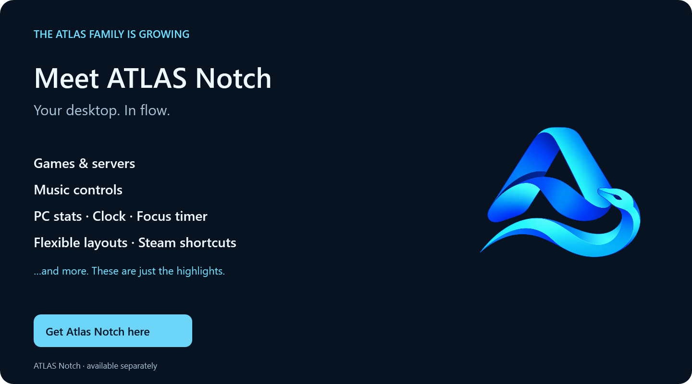

# What's new in V1.1.0

## New features

### The ATLAS family welcomes ATLAS Notch

Our new Windows desktop companion puts useful information and controls in a compact, customisable bar.

- Your current game and playtime, plus player numbers, latency and alerts for supported servers.
- Track information, music playback controls and volume adjustment.
- CPU, GPU and RAM usage, a clock and a focus timer.
- Small, Medium and Large layouts with their own module arrangements and smooth transitions.
- Steam account shortcuts through ATLAS Account Changer, with automatic account and group synchronisation.

…and more. These are just the highlights.
Notch is available separately and can also be used on its own.

[Get Atlas Notch here](https://bluelinede-shop.fourthwall.com/en-eur#top)

### ATLAS Tools

Open Notch directly, start it with Account Changer, or optionally close both together. The shop button disappears automatically when Notch is detected.

### A new entrance and a cleaner workspace

ATLAS opens and closes through its floating logo. A compact account header and refreshed About window keep the interface clear.

## Performance

### Less repeated work, the same smooth movement

Less repeated work for winter animations, Steam status updates and RGB outlines while preserving their appearance and smooth movement.

## Fixes

### More reliable Steam restarts

Steam restarts are now checked. A missing start is retried once; a failed restart ends the waiting animation and displays an error.

### Reliable support and shop links

Support and shop links can open through an installed browser if Windows cannot use its default HTTPS association.

### Aligned notes controls

Notes-table actions, search and table content now line up consistently, including wrapped toolbar rows.

## Install

Download **Atlas_Account_Changer_V1.1.0_Setup.exe** below for Windows 64-bit. The same installer handles new installations and updates. Existing accounts, settings and imported pictures are retained.

[Windows SmartScreen information](https://github.com/BluelineDE/atlas-account-changer#windows-smartscreen)
